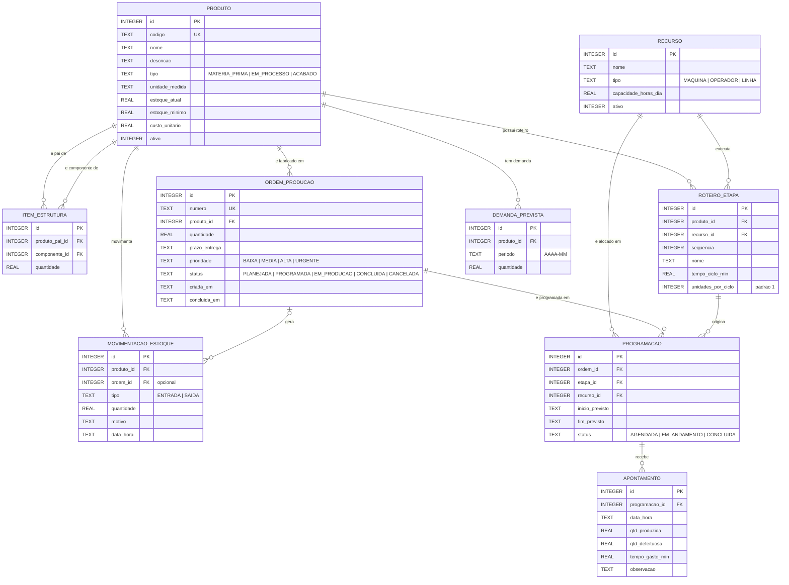

# 03 — Entidades e relacionamentos

Mapa dos requisitos do enunciado para as tabelas. O DER está em [der/der.mmd](der/der.mmd) e logo abaixo.

## Entidades

| Entidade | Papel | Requisito do enunciado |
|---|---|---|
| `PRODUTO` | Cadastro único de matéria-prima, produto em processo e acabado (campo `tipo`). Guarda saldo e estoque mínimo. | Estoque |
| `ITEM_ESTRUTURA` | Estrutura do produto: quanto de cada componente um produto pai consome. | Ordens de produção, Estoque |
| `RECURSO` | Máquina, operador ou linha, com `capacidade_horas_dia`. | Programação, Capacidade |
| `ROTEIRO_ETAPA` | Sequência de etapas de um produto, com recurso, tempo de um ciclo e unidades feitas por ciclo (paralelismo). | Programação |
| `ORDEM_PRODUCAO` | Produto, quantidade, prazo, prioridade e status. | Ordens de produção |
| `PROGRAMACAO` | Etapa de uma ordem alocada a um recurso com início e fim previstos (o cronograma). | Programação |
| `APONTAMENTO` | Produção real: quantidade boa, defeituosa e tempo gasto. | Desempenho |
| `MOVIMENTACAO_ESTOQUE` | Entradas e saídas de estoque, opcionalmente ligadas a uma ordem. | Estoque |
| `DEMANDA_PREVISTA` | Quantidade esperada por produto e mês. | Planejamento de capacidade |

## Relacionamentos

- `PRODUTO` 1—N `ITEM_ESTRUTURA` duas vezes: como **pai** e como **componente** (autorrelacionamento N—N).
- `PRODUTO` 1—N `ROTEIRO_ETAPA`, `ORDEM_PRODUCAO`, `MOVIMENTACAO_ESTOQUE`, `DEMANDA_PREVISTA`.
- `RECURSO` 1—N `ROTEIRO_ETAPA` e `PROGRAMACAO`.
- `ORDEM_PRODUCAO` 1—N `PROGRAMACAO`; 0..1—N `MOVIMENTACAO_ESTOQUE`.
- `ROTEIRO_ETAPA` 1—N `PROGRAMACAO`.
- `PROGRAMACAO` 1—N `APONTAMENTO`.

## Como saem os indicadores (sem tabela própria)

| Indicador | Cálculo |
|---|---|
| Qualidade | `sum(qtd_defeituosa) / sum(qtd_produzida + qtd_defeituosa)` |
| Eficiência | tempo padrão (`teto(qtd ÷ unidades_por_ciclo) × tempo_ciclo_min`) ÷ `tempo_gasto_min` |
| Produtividade | `qtd_produzida` por hora apontada |
| Cumprimento de prazo | ordens `CONCLUIDA` com `concluida_em <= prazo_entrega` |
| Gargalo / ociosidade | horas programadas no recurso ÷ (`capacidade_horas_dia` × dias do período) |
| Alerta de reposição | `estoque_atual < estoque_minimo` |

## Decisões de modelagem

- Um só cadastro de `PRODUTO` com `tipo`, em vez de três tabelas: a estrutura (BOM) liga qualquer produto a qualquer componente.
- `estoque_atual` é guardado no produto e atualizado a cada `MOVIMENTACAO_ESTOQUE` (o histórico fica na movimentação).
- Datas em `TEXT` ISO-8601 e booleanos em `INTEGER`, por serem os tipos nativos do SQLite.
- Integração com ERP/SGQ (desejável) não tem tabela: será uma interface na Application com implementação simulada.

## DER

